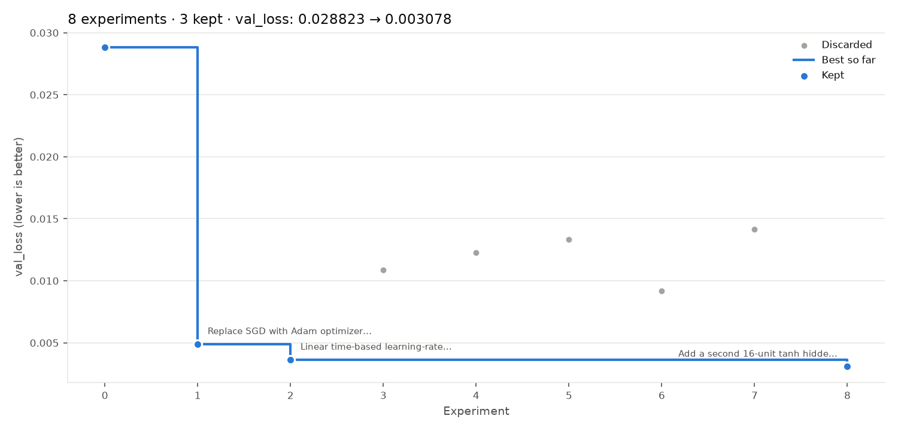
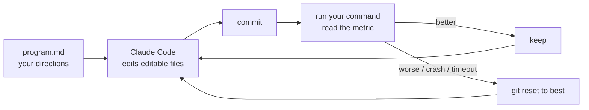

# My Autoresearch

Point it at a git repo and a metric. Claude Code changes your code one experiment at a time, the harness runs your benchmark, and only changes that improve the metric are kept. It's my take on [Karpathy's autoresearch](https://github.com/karpathy/autoresearch), for any repository and any metric.





```bash
autoresearch init                 # write autoresearch.toml + program.md
autoresearch run -n 20            # 20 experiments on branch autoresearch/<tag>
autoresearch report               # summary + progress.png
```

- [Instructions](docs/INSTRUCTIONS.md): setup, the example, using it on your project
- [System Design](docs/SYSTEM-DESIGN.md): architecture, flows, decisions, limits
- [File Structure](docs/FILE-STRUCTURE.md): what's where
- [Tiny MLP example](examples/tiny-mlp)
