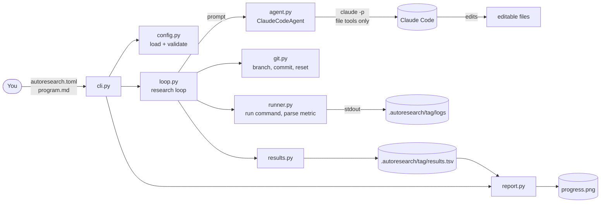
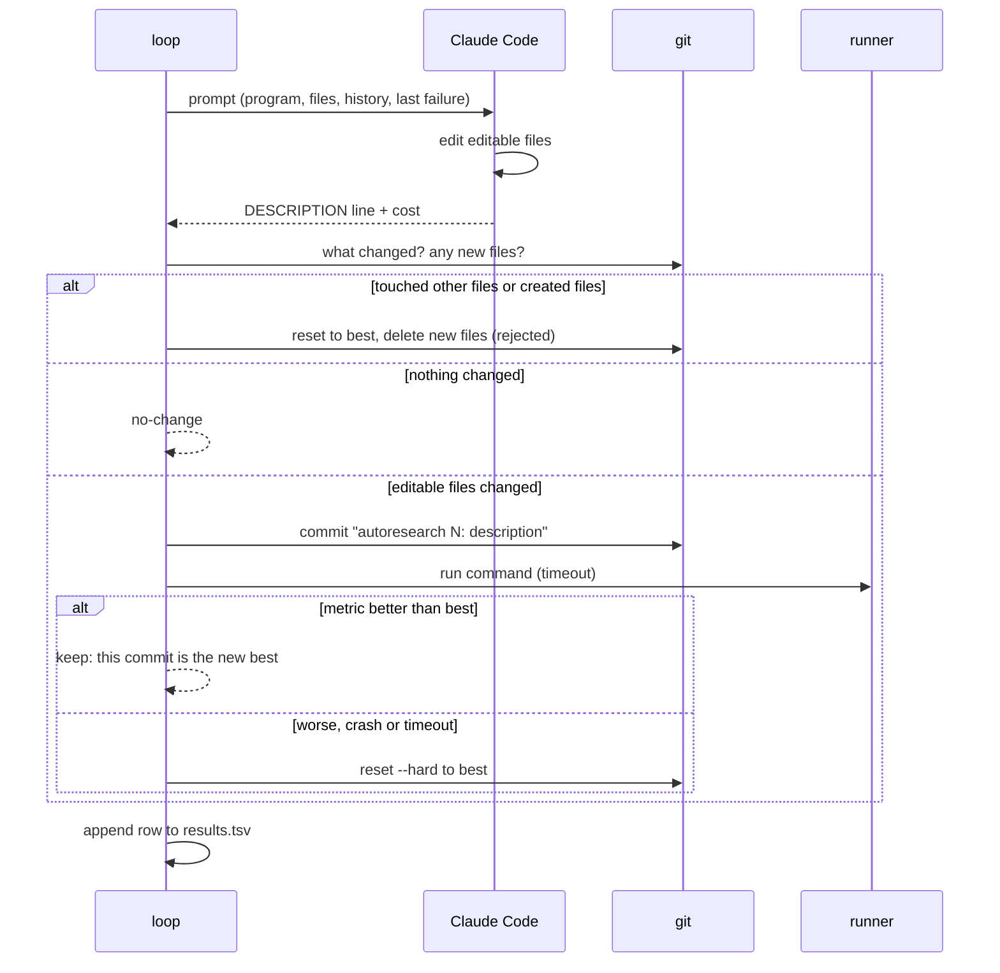

# System Design

My Autoresearch is a command-line tool that runs a research loop on any git
repository: an agent (headless Claude Code) makes one change, the tool runs your
benchmark command, and the change is kept only if the metric improves. It follows
the shape of Karpathy's autoresearch, but it works with any repository and metric,
and the harness, not the agent, owns git, running experiments and bookkeeping.

## Architecture

## Components

| Component | Job |
|---|---|
| `cli.py` | The `autoresearch` command: `init` writes templates, `run` starts the loop, `report` summarises a run and draws the chart. Turns expected errors into one-line messages. |
| `config.py` | Reads `autoresearch.toml`, applies defaults, checks it (required keys, goal, editable files exist, regex has a group). Knows how to recognise the metric and compare two values. |
| `loop.py` | The research loop and its rules (below). The only module that decides keep, discard or revert. |
| `agent.py` | Builds the prompt (program, editable files, history, last failure) and runs `claude -p` with only `Read, Edit, Write, Glob, Grep` tools and `acceptEdits` permissions. Parses the JSON result for the description and cost. Any object with `propose(prompt, cwd)` can replace it. |
| `runner.py` | Runs the command in its own process group with a timeout, writes the log, and takes the last metric value printed. |
| `git.py` | The handful of git operations the loop needs. |
| `results.py` | Appends and reads `results.tsv`; finds the best row. |
| `report.py` | Text summary and `progress.png` (all experiments, kept ones highlighted, running-best line). |

## Main flow: one experiment

Starting a run: check that the folder is in a git repository with no uncommitted
changes to tracked files, then switch to (or create) branch `autoresearch/<tag>`.
With no results yet, run the baseline; otherwise reset to the best commit so far and
continue numbering. Ctrl-C restores the best version and prints the report.

## Where data lives

| Data | Location |
|---|---|
| Setup | `autoresearch.toml` and `program.md` in your project (you commit these) |
| Kept changes | Commits on branch `autoresearch/<tag>`; discarded ones are reset away, so the branch is the chain of improvements |
| Every experiment | `.autoresearch/<tag>/results.tsv`: n, commit, metric, status, seconds, cost_usd, description |
| Command output | `.autoresearch/<tag>/logs/<n>.log` |
| Chart | `.autoresearch/<tag>/progress.png` |

`.autoresearch/` is added to `.git/info/exclude`, so it never shows up in commits and never needs a `.gitignore` change.

## Key decisions and trade-offs

- **The harness owns git and runs the experiment; the agent only edits files.** The
  agent has no shell, so it can't run the benchmark, look at the validation set by
  running code, or commit. That makes runs reproducible and cheating harder. The cost
  is that it can't do quick checks of its own (for example, a syntax check before
  the run), so a typo costs a full crash cycle.
- **Fresh agent per experiment, with history in the prompt.** Each `claude -p` call
  starts clean and sees the last `history` rows plus the last failure's output. That
  keeps context small and makes a long run behave the same at hour 1 and hour 10. The
  trade-off is that it loses the agent's own reasoning between experiments; only the
  one-line descriptions carry over.
- **Generic metric contract.** Any command that prints `name: number` works. The
  last value printed counts, so training logs that print the metric many times
  still work.
- **Strict scope.** Editing a non-editable file or creating a file gets the whole
  experiment rejected and reverted, rather than partly applied.
- **Keep only on strict improvement** (by more than `min_improvement`), so noise
  doesn't ratchet in changes that do nothing. If the benchmark is noisy, raise
  `min_improvement`.
- **Hardware is the target's business.** The tool never touches devices; the
  bundled example is CPU-only NumPy so it runs on any Mac.

## Testing

`uv run pytest` runs 19 tests in about 20 seconds, with no network and no Claude
usage:

- `tests/test_loop.py` drives the loop with a scripted fake agent against a throwaway
  git repository whose "benchmark" scores a number in `params.txt`. It covers keep,
  discard, crash, timeout, rejected edits, created files, no-change, agent errors,
  resuming, a dirty worktree, a failed baseline, maximize and `min_improvement`. It
  also checks that git history and the working tree end at the best version.
- `tests/test_parts.py` covers metric parsing, config errors, the real
  `ClaudeCodeAgent` against a fake `claude` executable (the flags it passes, JSON
  parsing, error handling), the report and chart, and the CLI.

End to end, the loop has been run with real Claude Code on `examples/tiny-mlp`
(see the README chart): 8 experiments, 3 kept, val_loss 0.0288 → 0.0031, $1.48 of agent cost.

## Known limits

- One experiment at a time; there is no parallel search across several workers.
- `git reset --hard` applies to the whole repository. The loop refuses to start
  with uncommitted tracked changes, but don't edit tracked files elsewhere in the
  repository while a run is going.
- The agent can only see the last `history` experiments; very long runs may
  revisit ideas that are older than that.
- Noisy benchmarks can let lucky runs in. The Tiny MLP example trains for a fixed
  *time*, so the step count varies with machine load: its best version scored
  0.0031 in the demo run and 0.0040 when re-run. Use `min_improvement`, or give
  the benchmark a fixed step budget, to stop chance from counting as progress.
- A metric only counts if the command exits 0 and prints it; NaN counts as a crash.
- Discarded experiments' commits are only reachable through the reflog, and each
  row's short hash, until git garbage-collects them.
- Costs are as reported by Claude Code; with a subscription login they are
  notional.
